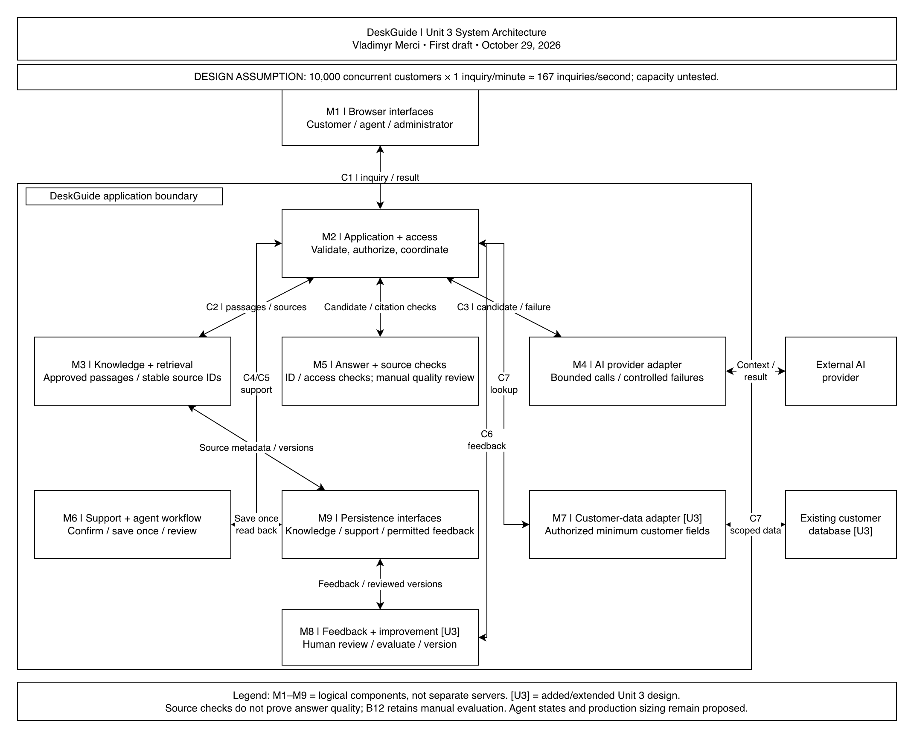

# Unit 3 architecture first draft

Author: Vladimyr Merci. Status: Vlad reviewed the first draft and authorized team review; peer review and final approval are pending.

## Shared editing sources

- [Edit the written draft in Google Docs](https://docs.google.com/document/d/1wdhA6LgOib5h5mo8p6onD87kleM75OCan0gPUZMNuC4/edit).
- [Edit the shared architecture diagram in draw.io](https://app.diagrams.net/#G1E3yDdOnoZSku1W8ejSJnkibDA3NcrGXO).
- [Open the same diagram file in Google Drive](https://drive.google.com/file/d/1E3yDdOnoZSku1W8ejSJnkibDA3NcrGXO/view?usp=sharing).

Both shared files allow anyone with the link to edit. Use the Google Doc for written recommendations and the shared draw.io file for diagram edits. Keep task status and agreed decisions in the [Unit 3 GitHub hub](../README.md) and [responsibility issue #11](https://github.com/vlad8110/deskguide/issues/11).

## Repository copies

| Material | Copy for review |
| --- | --- |
| Scope and backlog boundaries | [Scope statement](scope-statement.md) |
| Selected workload and open sizing decisions | [Workload assumptions](workload-assumptions.md) |
| Nine logical components | [Component responsibilities](component-responsibilities.md) |
| Supported answer and failure-to-human handoff | [Customer question walkthroughs](customer-question-walkthroughs.md) |
| Remaining work, owners and dates | [Review notes](review-notes.md) |
| Editable diagram snapshot | [Download the draw.io source](deskguide-unit-3-architecture.drawio) |
| Image preview | [Open the PNG](deskguide-unit-3-architecture.png) |

These files are snapshots of the shared review sources. Google Drive edits do not automatically update GitHub. Before publishing a revision, reconcile the current Google Doc and shared diagram, refresh the local copies and PNG, then commit and push when requested. PDFs are reserved for final submission.

The nine components are logical responsibilities rather than nine deployed servers. The selected design assumption is 10,000 concurrent customer sessions, each submitting one new inquiry per minute on average: approximately 167 new inquiries per second. Capacity is untested. M5 structural citation checks do not establish answer quality; B12 manual evaluation remains separate from live request processing.

The draft preserves the approved backlog boundary and identifies Unit 3 additions. Production sizing, service targets, provider allowances, detailed contracts and the final architecture rationale still require team work. Follow the [Week 3 schedule](../week-3-delivery-schedule.md) for review and Tuesday delivery.
