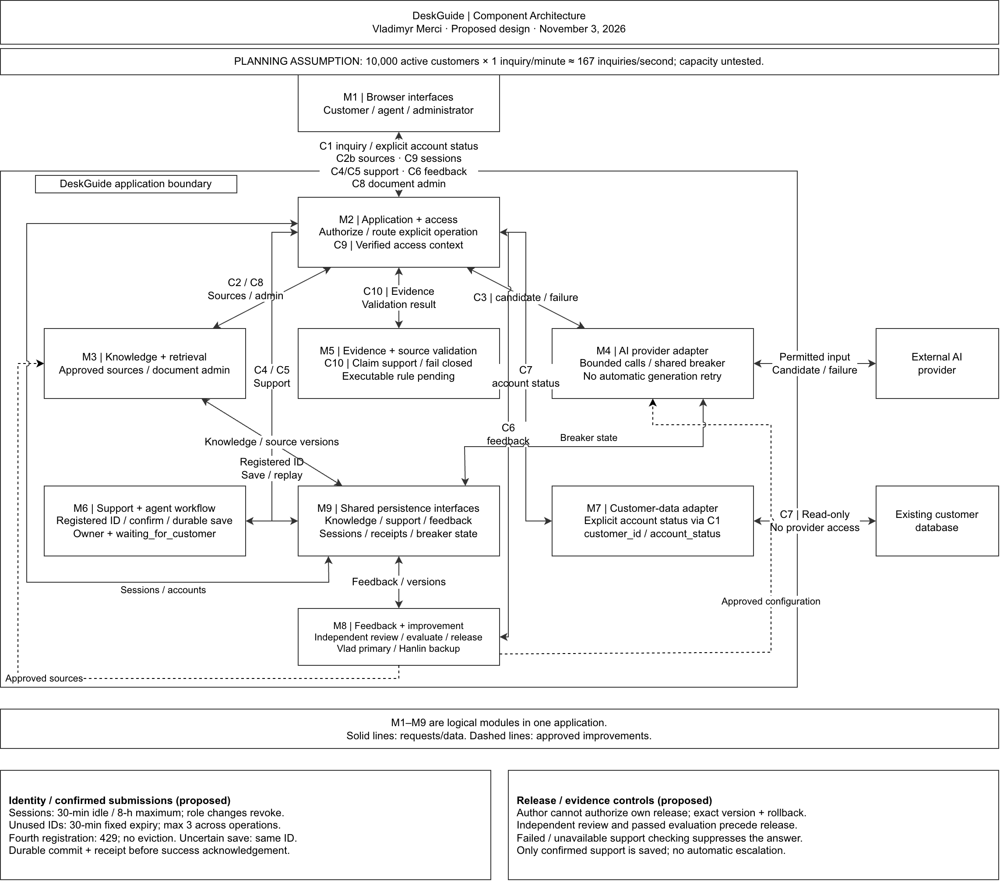
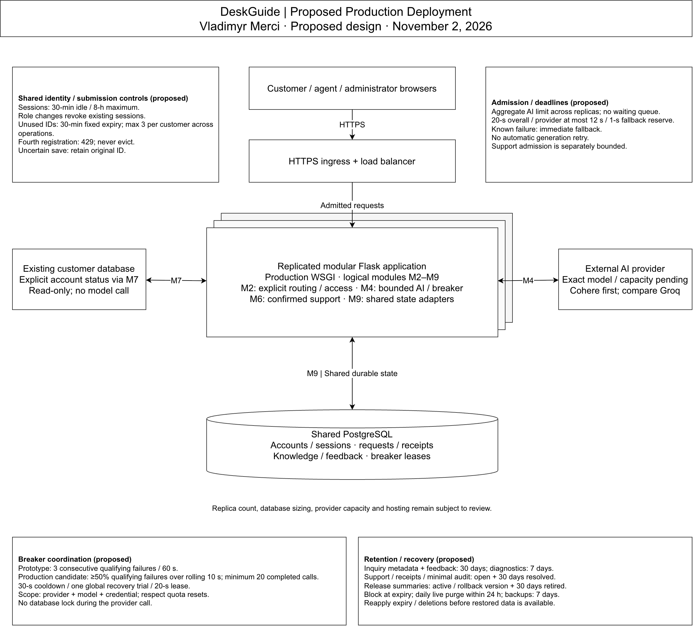

# Unit 3 architecture review

Author: Vladimyr Merci. November 5 C3 repository review revision, incorporating the November 3 shared-source flow correction and Hanlin’s accepted backup role. Current design direction: [proposed decisions](../proposed-decisions.md). Final combined-version approval remains pending.

Read the [complete architecture review document](architecture-review.md), the [Design Decisions and Review Log](../design-decisions-and-review-log.md), and the [rationale draft](../design-rationale.md).

## Written sections

| Material | Document |
| --- | --- |
| Scope and backlog boundaries | [Scope statement](scope-statement.md) |
| Workload, service target and open sizing decisions | [Workload assumptions](workload-assumptions.md) |
| M1–M9 and C1–C10 responsibilities | [Component responsibilities](component-responsibilities.md) |
| Supported answers and durable human handoff | [Customer question walkthroughs](customer-question-walkthroughs.md) |
| Remaining decisions, owners and dates | [Team review](review-notes.md) |

## Diagrams

The [editable draw.io source](deskguide-unit-3-architecture.drawio) contains two pages: **Component architecture** and **Production deployment**, revised November 3 to reflect the current proposals.

### Component architecture

### Proposed production deployment

M1–M9 are logical modules. The production proposal replicates one modular Flask application behind HTTPS ingress/load balancing with shared PostgreSQL state. The workload assumption is 10,000 active customer sessions averaging one inquiry per minute, approximately 167 inquiries per second. Capacity remains untested.

The diagrams include explicit account-status routing, proposed session/ID limits, non-author release authorization with Hanlin as the accepted backup, fail-closed evidence checking, and shared admission, breaker and retention policies. The combined contracts define the exact-match evidence policy and breaker algorithm. Reviewed fixtures, exact provider/model capacity, resource sizing and executed validation remain outstanding. See the [review log](../design-decisions-and-review-log.md) for owners and evidence requests.

## Shared editing sources

- [Architecture Google Doc](https://docs.google.com/document/d/1wdhA6LgOib5h5mo8p6onD87kleM75OCan0gPUZMNuC4/edit)
- [Shared draw.io diagram](https://app.diagrams.net/#G1E3yDdOnoZSku1W8ejSJnkibDA3NcrGXO)
- [Same diagram in Google Drive](https://drive.google.com/file/d/1E3yDdOnoZSku1W8ejSJnkibDA3NcrGXO/view)

The shared files remain the editable architecture sources. The November 3 walkthrough adds A3b: C2 retrieval → C10 prepare_evidence → [ready only] C3 generation → C10 validate → answer display. A failed or unavailable precheck makes zero provider calls and returns controlled fallback without saving a support request automatically. The shared walkthrough and component diagram show this same sequence. Follow the [Week 3 schedule](../week-3-delivery-schedule.md) for team agreement and submission.

Both diagram pages and PNG previews reflect the November 3 combined contracts: inquiry-bound evidence expectations, eligible outbound data, provider-versus-answer accounting, stage-dependent responses and Hanlin as backup. The shared draw.io file contains this same diagram. Final team approval remains pending.
