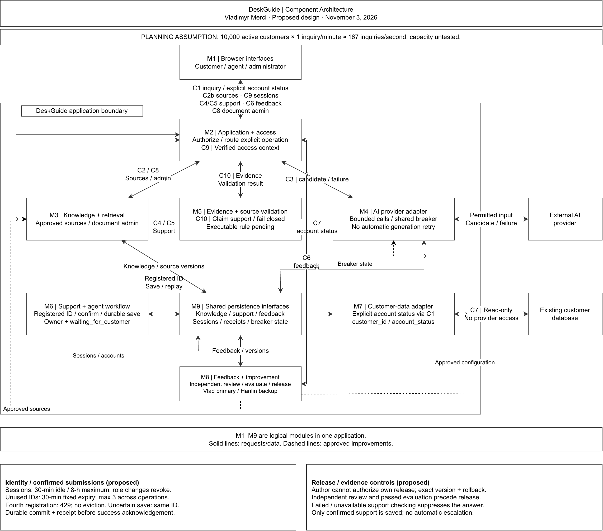
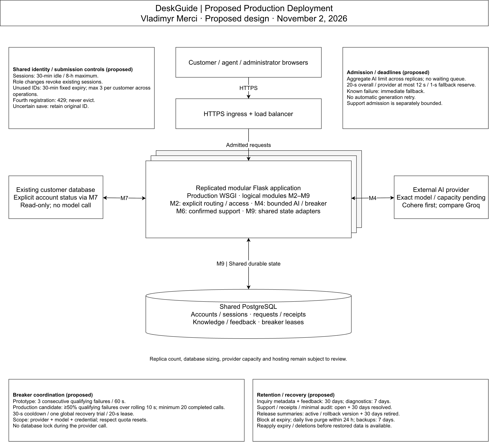

# DeskGuide Unit 3 — Architecture Review Draft

Vladimyr Merci | CMSC 495 Team 4 | November 2, 2026

Proposed architecture for team review. Responses are due Tuesday, November 3, 2026, at 10:00 a.m. Eastern. The design, contracts and rationale remain pending final team agreement.

## Working materials

Use this Google Doc and the shared draw.io file for architecture recommendations and corrections.

[Open the shared diagram in draw.io](https://app.diagrams.net/#G1E3yDdOnoZSku1W8ejSJnkibDA3NcrGXO)

[Open the diagram file in Google Drive](https://drive.google.com/file/d/1E3yDdOnoZSku1W8ejSJnkibDA3NcrGXO/view?usp=sharing)

[GitHub Unit 3 coordination hub](https://github.com/vlad8110/deskguide/tree/docs/unit-3-architecture-review/docs/unit-3)

[Week 3 delivery schedule](https://github.com/vlad8110/deskguide/blob/docs/unit-3-architecture-review/docs/unit-3/week-3-delivery-schedule.md)

[Vlad: architecture and coordination responsibility](https://github.com/vlad8110/deskguide/issues/11)

[Refined backlog](https://github.com/vlad8110/deskguide/blob/main/docs/backlog/refined-eight-week-backlog-v2.md)

[Refined four-week sprint backlog](https://github.com/vlad8110/deskguide/blob/main/docs/backlog/refined-four-week-sprint-backlog.md)

[Design Decisions and Review Log](https://github.com/vlad8110/deskguide/blob/docs/unit-3-architecture-review/docs/unit-3/design-decisions-and-review-log.md)

## Unit 3 — DeskGuide scope statement

### Scope statement

For Unit 3, I am designing DeskGuide as a customer-service platform that supports 10,000 concurrent customer sessions. Customers will ask basic service questions through an AI chatbot and receive answers grounded in approved knowledge documents, with links to the supporting sources. When the available evidence cannot support an answer, the question is too complex, or the AI service fails, DeskGuide will explain the limitation and offer a handoff to a human agent. Customers will review the information shared with the agent, and the system will acknowledge a support request only after it has been saved.

The initial customer-specific operation is an explicitly selected, read-only account-status check through C1/M7. The application reads only customer_id and account_status using trusted session scope and returns a fixed response without retrieval or model generation. Customer, agent and administrator permissions remain separate. Feedback informs bounded source or answering changes through independent review, evaluation, versioned release and rollback.

My architecture draft will show the system’s responsibilities, component boundaries, directional data flows, external connections, and capacity assumptions. I will keep those responsibilities clear enough for junior developers to understand and maintain. Hanlin’s interface contracts, Collins’s AI integration flows, and David’s verification plan will be checked against the same design.

### Behavior the architecture must cover

| Requirement | Scope for this draft | Backlog continuity |
| --- | --- | --- |
| Basic inquiries and supported answers | Retrieve permitted passages; return an answer with resolvable source references | B02, B07, B08, B10 |
| Complex, unsupported, or failed inquiries | Preserve the question; offer a customer-reviewed support request; save once despite retries; acknowledge the durable result; route to an authorized agent | B11, B13; B17 remains consolidated into B11 |
| Existing customer database | Explicit read-only account status: customer_id/account_status, trusted customer scope, no model call; unavailable data is explained without guessing | Production design addition P02; preserve B04/B09 authorization principles |
| Learning from interaction patterns | Review permitted feedback; independently evaluate versioned improvements; require non-author release authorization and a rollback reference | B13/B16 plus production design addition P04 |
| 10,000 concurrent customers | Use the highest previously proposed workload and document the resulting demand | Production design addition P01; preserve B05/B12 measurement requirements |
| Maintainability | Give components focused responsibilities, explicit contracts, and understandable failure behavior | B03, B04, B19 |

### Boundaries for Unit 3

This is a system design specification. The first draft does not include application implementation, a live deployment, actual customer-database access, or measured proof of 10,000-customer capacity. Examples and any later local demonstrations will use fictional documents and synthetic customer data.

Proposed production design: one modular Flask application replicated behind HTTPS ingress, with shared PostgreSQL state. Improvements require independent review, passed evaluation, versioning and non-author release authorization. Automatic second-provider failover remains deferred. Provider capacity, hosting and deployment sizing require evidence.

The original employee-support prototype remains the backlog baseline. This Unit 3 draft extends that baseline to the customer-service requirements without claiming the earlier Flask/SQLite prototype already satisfies production capacity.

### Working dates

Team responses: Tuesday, November 3, 2026, at 10:00 a.m. Eastern; I will consolidate replies afterward. Working submission cutoff: November 3 at 11:59 p.m. Eastern. Unanswered technical items remain open.

### Source basis

- [Unit 3 assignment requirements](https://github.com/vlad8110/deskguide/blob/main/docs/unit-3/assignment-requirements.md)

- [Refined eight-week backlog](https://github.com/vlad8110/deskguide/blob/main/docs/backlog/refined-eight-week-backlog-v2.md)

- [Refined four-week sprint backlog](https://github.com/vlad8110/deskguide/blob/main/docs/backlog/refined-four-week-sprint-backlog.md)

- [Current assignment requirements](https://github.com/vlad8110/deskguide/blob/main/docs/unit-3/assignment-requirements.md)

The source backlog’s prototype estimates remain historical. Additional production-design work must be estimated separately.

## Unit 3 — Selected workload assumptions

### Selected scenario

Planning assumption: 10,000 active customer sessions, each submitting one new inquiry per minute on average. This implies approximately 166.67 inquiries per second. The assignment specifies concurrency; this arrival rate is our proposed workload assumption, not measured usage or demonstrated capacity.

A concurrent session means a customer is using the service during the same period as the other customers. It does not by itself specify a persistent network connection or mean all 10,000 customers submit at the same instant. This baseline assumes inquiries are distributed over the minute; synchronized demand is considered separately below.

### Baseline demand

| Quantity | Calculation | Design demand |
| --- | --- | --- |
| Concurrent customer sessions | Selected scope | 10,000 |
| New inquiries per customer | Selected busiest scenario | 1 per minute |
| New inquiries per minute | 10,000 × 1 | 10,000 |
| Average new inquiries per second | 10,000 ÷ 60 | 166.67, approximately 167 |
| New inquiries in one hour at this sustained rate | 10,000 × 60 | 600,000 |

Calculations below use the unrounded rate, 10,000 ÷ 60. The 167 figure is a rounded description, not an extra capacity allowance. This rate counts new customer inquiries only; retries, citation clicks, authentication, feedback, agent actions, database calls, and health checks add separate work.

### Simultaneous work depends on response time

For a stable workload, average in-flight inquiries can be estimated as average arrival rate multiplied by average end-to-end time. The following values are illustrations, not measured results or safe concurrency settings.

| Illustrative mean end-to-end time | Calculation | Estimated average in-flight inquiries, rounded up |
| --- | --- | --- |
| 5 seconds | (10,000 ÷ 60) × 5 | 834 |
| 10 seconds | (10,000 ÷ 60) × 10 | 1,667 |
| 15 seconds | (10,000 ÷ 60) × 15 | 2,500 |

These averages do not size a queue, predict peak concurrency, or establish a safe server count. A system that receives work faster than it can finish it will accumulate waiting work; a stable-average calculation does not prove it can sustain the arrival rate.

### AI-service demand assumption

For the worst-case planning scenario, every new inquiry requires one generation call: approximately 166.67 calls per second, 10,000 per minute or 600,000 per hour. Caching is not credited toward capacity. Additional model calls would increase demand.

Evaluate Cohere first and compare Groq on the same questions before selecting an exact model. Free evaluation access is for the fictional-data prototype only. Collins supplies account/model request and token quotas, concurrent-call limits, data/retention policy, latency evidence and a production capacity/cost proposal. Include any model calls used for evidence checking. A paid key alone does not establish capacity for 10,000 calls per minute; simulated application load does not prove provider capacity.

### Separate synchronized stress scenario

Proposed controlled load scenarios: approximately 166.67 inquiries/second for ten minutes; 333.33 inquiries/second for two minutes; and a separate overload case of 10,000 arrivals within one second. Agree resources and stop conditions before execution. Use controlled substitutes before any permitted live-provider test.

Use an aggregate AI admission limit across application instances, with no AI waiting queue. Return a controlled busy response when admission is unavailable. Prototype generation concurrency may be up to five only where account/model quotas permit; also enforce request and token budgets. Production concurrency remains pending quota and service-time evidence. Keep support-save/status admission separately bounded; replicas and agent work are not unlimited.

### Decisions still needed before sizing or validation

| Decision | Who helps resolve it | Why it matters |
| --- | --- | --- |
| Validate proposed service, failure and recovery targets | Vlad + David; Collins checks provider behavior | Defines acceptable service, rather than inferring it from illustrative averages |
| Prompt/answer sizes, inquiry mix, and number of external calls | Collins + Hanlin | Determines token demand, payloads, and dependency traffic |
| Customer-data lookup and escalation/feedback rates | Vlad + Hanlin + Collins | Determines database and agent-workflow demand |
| Aggregate admission limits, safe retries and overload responses | Vlad + Hanlin + Collins; David reviews | Prevents uncontrolled waiting and duplicate work |
| Production replica counts, resource limits and database sizing | Vlad; David reviews assumptions | Must follow measured capacity or justified estimates, not a guessed server count |
| Burst profile, test duration, environment, and provider allowances | David + Vlad + Collins | Makes the validation reproducible and distinguishes mocked from real dependencies |

Proposed AI service level: at least 95% of all eligible inquiries received return a supported AI answer within 15 seconds at the selected workload. Before testing, identify eligible questions, expected outcomes and source versions; another qualified member reviews the labels. Otherwise-eligible busy, timeout, invalid-answer and unnecessary-fallback outcomes count as misses. Do not relabel failures afterward. Report account-status checks, explicit human requests and unsupported questions separately.

Use a 20-second overall deadline, a provider wait of at most 12 seconds and a one-second fallback reserve. Shorten dependency waits to the remaining budget and stop waiting by approximately second 19. Return fallback as soon as failure is known. A 12-second provider call leaves only three seconds for other work to meet the 15-second target; timeout settings do not prove performance.

Proposed support-save target: at least 95% of valid, confirmed intended submissions are durably committed with the success response ready within two seconds of application receipt of the final submission. Count slow saves, definite failures, uncertain commits and capacity rejections as misses. Count each intended submission once; track every retry separately while retaining its original ID and timing. Late reconciliation cannot turn an untimely result into a timely success. Measure registration separately; exclude form editing and human response time. Report invalid, unauthorized, expired-ID and conflicting-payload attempts separately.

## Architecture diagram

[Edit the live diagram in draw.io](https://app.diagrams.net/#G1E3yDdOnoZSku1W8ejSJnkibDA3NcrGXO)

[Figure 1. November 2 proposed component architecture. M1–M9 are logical modules.](deskguide-unit-3-architecture.png)

### Proposed production deployment

[Figure 2. November 2 proposed deployment, shared controls and retention policies.](deskguide-unit-3-production-deployment.png)

## Unit 3 — Component responsibilities

Production proposal: HTTPS ingress/load balancing distributes requests across modular Flask replicas using production WSGI. Shared PostgreSQL holds durable application state through M9. The existing customer database remains a separate read-only dependency. Hosting, replica counts, database sizing and provider capacity remain pending.

### Component proposal

I propose separating DeskGuide into the following logical components. Each component has one main responsibility and communicates through a defined interface. These boundaries will guide the architecture diagram and the team's contracts.

| ID | Component | Main responsibility | Information and interactions | Backlog / contract alignment |
| --- | --- | --- | --- | --- |
| M1 | Browser interfaces | Present customer questions/results, human-agent work, and authorized administration | Sends customer, agent and administrator actions to M2. C1 includes an explicit account-status operation selector; the server determines the response route. Displays authorized sources and controlled outcomes. Uses server-issued IDs and shows saved-request acknowledgement only after durable commit. | B03/B08/B13/B14; C1/C4/C5/C6/C8 |
| M2 | Application and access control | Validate requests, enforce permissions and customer scope, and coordinate use cases | Derives trusted C9 context from the validated session; authorizes role, customer and object scope before protected operations. Validates the requested operation, enforces aggregate admission and CSRF checks, and coordinates deadlines. Sessions use shared expiry/revocation state with 30-minute idle and eight-hour absolute limits. | B04/B06/B09; C9 access context across protected C1–C10 operations |
| M3 | Knowledge and retrieval | Manage approved knowledge versions and retrieve only passages the caller may access | Returns approved passages with stable document, section and version identifiers. C8 restricts document administration to authorized administrators. Approved source changes from M8 enter through this boundary. | B02/B07/B14; C2 retrieval; C8 document administration |
| M4 | AI provider adapter | Isolate external generation and provider-specific failure behavior | Sends only permitted generation input, excluding credentials, C9 context and customer-database fields. Uses at most 12 seconds within the remaining 20-second deadline minus the one-second fallback reserve; no automatic retry. Prototype breaker: three consecutive qualifying failures within 60 seconds, reset by success. Production candidate: at least 50% qualifying failures among completed calls over rolling ten seconds, minimum 20 completed calls. Both use a 30-second cooldown, one global trial and a 20-second lease in M9, scoped to provider/model/credential. Respect quota resets; do not hold a database lock during the call. Collins specifies exact counters, resets, stale-result and write rules. | B05/B10/B11; C3 |
| M5 | Answer and source validation | Validate candidate structure, authorized citations and evidence under C10 | Checks candidate structure, permitted source membership, versions, access, resolvability and actual claim support under C10. Collins supplies executable pre-generation sufficiency and runtime support rules, thresholds and any additional model calls. Valid citations, matching quotations or model confidence alone are insufficient. If checking fails, times out or cannot run, suppress the candidate and return controlled fallback/support. B12 manual evaluation remains separate; the missing rule is pending evidence. | B07/B10 runtime checks; C10 validation; B12 offline manual evaluation |
| M6 | Escalation and agent workflow | Manage the durable customer-to-human handoff | Registers IDs before confirmation, scoped to customer/operation and parent request for replies. Unused IDs expire 30 minutes after registration; cap three unused, unexpired IDs per customer across operations. Reject a fourth with 429; never evict an older ID. Atomically enforce the cap and save confirmed content plus its receipt through M9. Acknowledge only durable results; uncertain saves retain the same ID. Enforce agent ownership and versioned state transitions. | B11/B13; C4/C5; B17 remains consolidated into B11 |
| M7 | Customer-data adapter | Limit access to the existing customer database through a stable boundary | Handles the customer's explicit account-status selection through C1. Reads only customer_id/account_status using authenticated scope and returns a fixed response without retrieval or model generation. General knowledge questions need no lookup. Account changes go to human support. Do not guess on database failure or send database fields to the provider; confirmed support saving uses trusted identity even when customer data is unavailable. | Production addition P02; B04/B09; C7 |
| M8 | Feedback and reviewed improvement | Turn permitted feedback/patterns into evaluated, controlled improvements | Accepts permitted inquiry-linked feedback, including fallback without an answer. A different qualified member reviews each change; evaluation passes and a rollback reference is recorded. Vlad is primary release authorizer and Hanlin is the accepted backup. An author cannot authorize their own change. A designated independent reviewer may also authorize with explicit release permission. If neither named authorizer is independent/available, designate a qualified non-author first. Release exactly the reviewed version. Approved sources use M3/C8; generation configuration uses M4. No automatic training or release from ratings. | B13/B16; production addition P04; C6 |
| M9 | Persistence adapters | Provide durable storage through component-owned data interfaces | Shared PostgreSQL holds application accounts/sessions, knowledge versions, support requests/replies/completed receipts, permitted feedback, audit/release summaries and breaker coordination state. Components retain control of their records and rules. Do not persist general chat transcripts. Authentication credentials/roles remain in the controlled application account store, separate from the existing read-only customer database. | B06/B11/B13; durable interfaces for knowledge, support, feedback, sessions and shared breaker state |

### Backlog and Unit 3 scope

These nine responsibilities are derived from the team backlog with Unit 3 design additions. M7 customer-database integration is a Unit 3 addition. M6 agent assignment/states, M8 governed improvement/versioning, and production admission/isolation policies extend the prototype backlog. B13/B14 feedback, request review and document administration are later full-backlog items, outside the four-week B01–B12 extract. These additions do not by themselves create new team implementation commitments.

### External boundaries

The external AI provider and existing customer database remain outside the application boundary. Browsers are untrusted. Use opaque server-side sessions in Secure, HttpOnly, SameSite=Lax cookies and CSRF protection on state-changing requests. Proposed session limits are 30 minutes idle and eight hours absolute; authenticated activity renews idle expiry only. Rotate the session ID at login. Role/permission changes revoke existing sessions and require login. Enforce expiry/revocation across instances; logout invalidates the current session.

Start with one company and controlled provisioning through a protected management command or approved bulk import. Use fictional prototype accounts, with no public signup or role picker. Map customers to approved existing customer IDs; retain password hashes and roles in the separate application store. Customers access their own objects; agents access unassigned work and their assigned requests. Document administrators have no automatic support-content or feedback access. Assign reviewer/release permissions explicitly and check protected objects server-side.

M9 provides component-owned persistence interfaces over shared PostgreSQL. M3, M6 and M8 retain their data rules; replicas share session, receipt and breaker state. The existing customer database stays separate and read-only.

Proposed retention: inquiry metadata and linked feedback last 30 days from inquiry creation. Diagnostics last seven days and exclude raw content, credentials and direct customer identifiers. Keep confirmed support content, replies, completed receipts and minimal associated action audit while the request is open plus 30 days after resolution. Review old open work rather than automatically deleting unresolved requests. Do not store general chat transcripts or raw conversations/feedback in audit and evaluation summaries.

Retain evaluation/release summaries for active or retained rollback versions, then 30 days after the associated version is retired. Rotate encrypted daily backups after seven days. Block access at expiry and purge live records during the next daily cleanup within 24 hours; delete linked feedback with inquiry metadata. Track live deletion separately from backup expiry. Reapply current expiry rules and recorded deletions before restored data is available. Collins supplies the selected provider's policy for provider-held copies.

M2 supplies verified C9 access context to protected internal operations and a correlation ID for safe diagnosis. Browser-provided identity/role fields are not authority. C9 credentials/context are not sent to the external model. Document administration does not grant customer-support access. Operational logs avoid unnecessary raw questions and customer data.

Source-ID, quotation and access checks do not by themselves establish answer support. Keep executable pre-generation and runtime evidence policies separate from offline B12 review. If the support rule is unavailable, retain the fail-closed interface and mark the rule pending; do not claim completed supported-answer functionality or a passed service target.

### Boundaries to settle with the team

| Person | First review needed |
| --- | --- |
| Vlad | Confirm the service-level denominator, deployment proposal and cross-component boundaries; reconcile diagram, contracts and rationale for one final team review. |
| Hanlin | Align C1–C10 with the proposed session/ID values, combined ID cap, explicit account-status request selector, provisioning/permissions, non-author release authority, ownership/version checks and denominator-aware save timing. |
| Collins | Supply exact provider/model quotas and data policy, executable evidence-support rules, production-breaker window/reset/write details and deadline/outcome confirmation. |
| David | Verify fixed test labels and denominators, registration/replay/cleanup races, session/ownership isolation, non-author release, deletion/restoration and shared-breaker concurrency/recovery. |

### Implications of the selected workload

M1–M9 are logical modules, not nine services. Replicate one modular Flask application behind a load balancer with shared PostgreSQL state and aggregate bounded admission. The proposed AI target is 95% of eligible inquiries answered with support within 15 seconds; the hard deadline is 20 seconds with a one-second fallback reserve. Support saving has a separate two-second/95% target. Provider capacity, sizing and support limits still require evidence.

## Unit 3 — Customer question walkthroughs

These two walkthroughs turn the component responsibilities into interactions for the architecture diagram. They describe intended behavior, not implemented or tested results. The workload remains 10,000 concurrent customer sessions at about 167 new inquiries per second.

### Backlog boundary

The supported-answer flow follows B04/B07/B08/B09/B10. The fallback and single-save behavior follows B11, including failure handling consolidated from B17. B12 manual evaluation remains separate from runtime validation and production load testing. B13 adds saved feedback and review by explicitly authorized staff later in the full backlog; administrator status alone does not grant support access. B13 remains outside the B01–B12 four-week extract.

Customer-specific authorization, an existing customer-database adapter, and agent assignment/status details are proposed Unit 3 design additions. These walkthroughs do not present them as previously approved implementation commitments.

### Walkthrough A — A question with available supporting sources

Illustrative question: “Where can I find the customer portal setup instructions?” Assume an approved fictional guide exists for the example. This does not assert that the document or evaluation case has already been created.

Expected outcome: the customer sees an answer that passes the executable support policy with working, authorized source references. B12 independently evaluates answer quality; source validity alone does not prove support.

| Step | Component responsible | Information passed / intended action | Failure or alternate outcome |
| --- | --- | --- | --- |
| A1 | M1 Browser interfaces → M2 Application/access control | Submit the knowledge question and requested operation through C1, using the authenticated session cookie and server-associated inquiry/correlation ID. Show pending status. Hanlin aligns the operation selector and size limits. | Empty/oversized input receives validation feedback. Keep editable question text in the current form. |
| A2 | M2 Application/access control | Validate input, session and selected operation; derive trusted C9 role/customer/document scope, assign a correlation ID and apply aggregate admission. Account-status selection follows the separate read-only path below. | Deny unauthorized access. If admission/dependency capacity is unavailable, return a controlled status and preserve the question; do not wait indefinitely. |
| A3 | M2 → M3 Knowledge/retrieval; M3 → M9 storage interfaces as needed | Pass the question and trusted permitted-source scope. Retrieve approved passages with stable document, section and version identifiers. Return the permitted passage set to M2. | If no relevant permitted evidence is available, use Walkthrough B without calling the model to invent an answer. Retrieval failure is reported as unavailability, not as proof that no source exists. |
| A4 | M2 → M4 AI provider adapter → external AI provider | Send only the permitted question and retrieved passages with source IDs. Keep C9 context and database fields inside DeskGuide. Wait at most 12 seconds or the remaining overall budget minus the one-second fallback reserve, whichever is shorter; stop dependency waiting by approximately second 19. | On timeout, quota failure, malformed output or open circuit, follow Walkthrough B without an automatic generation retry or second-provider failover. |
| A5 | External provider → M4 → M2 | Return a structured candidate answer and source identifiers associated with the same inquiry. | A result arriving after timeout/cancellation is obsolete and must not overwrite the current fallback view or create a support request. |
| A6 | M2 → M5 Answer/source validation, with M3 resolving source references | Apply C10 structure, permitted source/version/access and actual answer-support checks after the pre-generation evidence-sufficiency gate. Return the result only when the executable policy passes; otherwise suppress the candidate and return a controlled outcome. | Reject inaccessible, unknown or unresolvable sources and unsupported claims. If validation fails, times out or cannot run, use controlled fallback with a support option. Collins's exact rules remain pending; B12 manual review is separate. |
| A7 | M2 → M1 Browser interfaces | Return the result that passed the agreed runtime validation policy, its authorized source references and the matching inquiry ID. Display citations beside the answer. | A disconnected browser must not cause an unrelated or stale result to replace a newer inquiry. No general conversation-history persistence is assumed. |
| A8 | M1 → M2 → M3 when a source is opened | Recheck access to the selected document/section/version and return the authorized source content. | If access changed or the source cannot be resolved, show a clear unavailable/denied result rather than another customer's content or a silently substituted passage. |

Main diagram path: M1 → M2 → M3 → M2 → M4/external AI → M2 → M5 → M2 → M1. M3 uses its M9 storage interface where needed. The return to M2 denotes orchestration, not a requirement to deploy every component separately.

Customer-data boundary: this general question needs no lookup. For the separate account-status use case, the customer explicitly selects Check my account status through a C1 request selector; a response-side route field alone does not provide that selection. M2 validates the action and scope, calls M7 for customer_id/account_status and returns fixed text without retrieval or AI generation. No database fields reach the provider. Unavailable data is explained; confirmed support saving remains available using trusted identity.

### Walkthrough B — Unsupported/complex inquiry or AI failure, followed by a support request

Entry conditions: no permitted supporting passages; an explicit request for a person or an agreed complexity-routing rule; invalid citations/output; or retrieval/provider timeout, quota or service failure. Keep “insufficient evidence” distinct from “service unavailable.” Complexity and evidence-sufficiency policies are still proposed design decisions.

Expected outcome: the customer receives a clear limitation and can choose to create one durable support request. A saved-request acknowledgement means storage succeeded; it does not mean an agent accepted or resolved the request.

| Step | Component responsible | Information passed / intended action | Failure or alternate outcome |
| --- | --- | --- | --- |
| B1 | M2 Application/access control → M1 Browser interfaces | Return a safe limitation/unavailability reason and the support-request option. Retain the original question in the current editable form. | Hide credentials, raw provider errors and unnecessary internal details. Keeping text in this form does not promise survival across a page reload. |
| B2 | Customer through M1 | When the support form opens, register an unused server-issued ID bound to the customer and operation. Reply IDs also bind the parent request. The customer reviews/edits the content and explicitly confirms or cancels; registration alone creates no visible support request. | Unused IDs expire 30 minutes from registration. Atomically allow at most three unused, unexpired IDs per customer combined across escalation/reply operations. A fourth registration returns 429 with a pending-limit message; never evict an older ID. Expired IDs do not consume slots. Completed receipts follow request retention instead. |
| B3 | M1 → M2 → M6 Escalation/agent workflow | Submit final confirmed content and the registered ID. Revalidate session, customer/operation/parent scope, content and unused-ID validity. Time the support-save operation from application receipt to durable commit and success-response readiness; registration is measured separately. Server deduplication is mandatory. | Reject expired/unknown IDs or unauthorized input with a controlled response. Preserve editable content. Do not recreate an expired request by silently generating a new ID. |
| B4 | M6 → M9 persistence interface | In one transaction, atomically create the support request and its completed receipt under the unique customer/operation/submission identity. Bind the receipt to the confirmed payload so repeats can return the committed result. | If the transaction is known to have failed without saving, report “not saved.” If its outcome is uncertain, report “confirmation unavailable” and resolve using the same identity; do not assert that no record exists. |
| B5 | M9 → M6 → M2 → M1 | After durable commit, return the saved request ID and acknowledgement. | If commit succeeds but acknowledgement is lost, replaying the same authorized ID/payload returns its completed receipt and existing request. Retain completed receipts for the request lifetime and 30 days after resolution. |
| B6 | M2/M6 on retry | Check the registered ID, authorized customer/operation scope, payload match and completed receipt before deciding whether to create, replay or reject. | Completed same-ID/same-content requests return the existing result; changed content conflicts. Unknown or expired unused IDs are rejected, never recreated. Cross-customer receipt lookup is denied. Only a deliberate new submission gets a fresh server-issued ID. |
| B7 | Agent interface M1 → M2 → M6 → M9 | A permitted human opens the saved-request list/detail. Enforce role and record scope on the server before returning content. | Restrict unauthorized requests. Document-administration rights alone do not grant access to customer conversations or support requests. |
| B8 | Agent interface → M2 → M6 → M9 | Proposed states: queued → assigned → in_review → waiting_for_customer → in_review → resolved. Claim/assignment and transitions use atomic owner/version checks. Only the owner changes assigned work within permitted transitions; unfinished work may be released to queued with a reason. | Resolved is terminal; late replies do not reopen it. Stale concurrent changes conflict. A permitted customer reply to waiting_for_customer returns the request to in_review and retains the assigned agent. Hanlin aligns exact contracts; David verifies claim/reply/resolution races. |

Main diagram path: fallback reason → M2 → M1/customer confirmation → M2 → M6 → M9 durable save → M6/M2 → M1 acknowledgement. The agent later follows M1 → M2 → M6 → M9 for permitted review and updates.

Capacity boundary: AI admission and support-request admission are separately bounded. Provider limits, database capacity and agent throughput constrain service. David will test the proposed load and recovery scenarios; numerical in-flight and support limits require sizing evidence.

### Verification and draft contracts

| Check | Expected design behavior / backlog basis |
| --- | --- |
| Supported question and source click | Stable authorized source IDs resolve; expected supporting passages and answer support are manually evaluated under B07/B12. |
| Missing evidence / explicit human request | No unsupported answer is invented. Failed, timed-out or unavailable evidence checks suppress candidates; the customer chooses whether to submit support. Verify supported, unsupported and check-unavailable outcomes. |
| Timeout, quota failure, service failure and malformed output | Use delivered 200 temporarily_unavailable for controlled provider fallback, 429 for customer limits, 503 SERVICE_BUSY for aggregate overload and 504 DEADLINE_EXCEEDED when the deadline expires and a response remains deliverable. Keep C10 validation outcomes distinct; preserve the original question without raw error/secret disclosure. |
| Invalid or inaccessible citation | Reject invalid sources and unsupported candidates under C10 without bypassing permissions. Preserve the independently reviewed B12 set: 12 supported, four unsupported and four ambiguous questions. Existing gates are 10/12 supported correct and all four unsupported falling back; assess ambiguous cases individually. |
| Confirm, cancel, repeat submit, changed content and lost acknowledgement | Cancel creates no support request. Same-ID/same-payload retries replay the committed result; changed payload conflicts and unknown/expired unused IDs cannot create records. Verify atomic three-ID registration, no eviction, cleanup/commit races, duplicate replies and uncertain saves retaining their original ID. |
| Customer/agent permissions and customer-data access | Deny unauthorized/cross-customer access; synthetic examples only. Agent/customer-data extensions are Unit 3 design work. |
| Provider response arriving late | Correlate inquiry results and suppress obsolete UI updates; never auto-save a support request because a provider returned late. |
| Workload and regression | Before testing, fix and independently review eligibility labels, expected outcomes and source versions. Count otherwise-eligible busy/failure outcomes as misses. Measure the 95%/15-second AI target and separate 95%/two-second durable-save target. Simulate ten-minute 166.67/s, two-minute 333.33/s and separate 10,000-arrival/one-second overload cases. B12 and small live-provider checks do not establish production capacity. |

Contract mapping: C1 inquiry/result and explicit account-status selection; C2 retrieval/sources; C3 generation; C4 registered support submission/receipts; C5 agent workflow/replies; C6 feedback/reviewed improvement; C7 read-only customer lookup; C8 document administration; C9 verified access context; C10 runtime evidence/source validation. Hanlin aligns schemas, errors and measurement boundaries with the diagram and proposed decisions.

### Remaining contract and verification work

- Collins: provide executable evidence rules, provider/model quota/data-policy evidence, production breaker window/counter/reset/write rules, and deadline/outcome confirmation.

- Hanlin: align the proposed session/ID values, combined cap, explicit account-status selector, provisioning/permissions, release authorization and save measurement contracts.

- David: review fixed labels, save denominators, session/ID/ownership races, non-author release, deletion/restoration and shared-breaker recovery. These checks remain planned.

- Vlad: reconcile cross-component findings, proposed deployment and final rationale, then obtain all four reviews of one final version.

## Unit 3 — Proposed privacy decisions

### D22 — Outbound-data eligibility for external AI

Status: Pending team approval.

Raised by: [David's issue #8 proposal](https://github.com/vlad8110/deskguide/issues/8#issuecomment-6590423959), supported by his [issue #5 provider comparison](https://github.com/vlad8110/deskguide/issues/5#issuecomment-6590430685). Owners: Vlad trust boundary and classification approval, Collins outbound policy/provider controls, Hanlin contract outcomes, David verification.

Deny externally hosted generation unless both the user question and every retrieved passage included in the request are explicitly eligible. Proposed eligible classes are synthetic, public or specifically approved for the selected external model. Internal-confidential material, personnel/HR complaints, credentials, regulated or restricted records and unclassified/unapproved content are blocked unless separate documented authorization and controls permit the specific disclosure. Minimize unnecessary identifiers; redaction alone does not establish eligibility. Enforce the decision server-side before the provider call. If eligibility or required provider controls cannot be established, make no external call and use an authorized retrieval-only response or human-support path; local/restricted inference requires a separately approved configuration.

Keep the classroom prototype limited to fictional questions and passages. Preserve D16's account-status path: fixed authorized response, no model generation and no customer-database fields sent to AI. D09's application retention rules do not establish provider retention; Collins must confirm the exact tier/model, actual data controls, exceptions, permitted data, quotas and cost under D13 before recommending the provider. Cohere remains the first prototype candidate for comparison with Groq; this proposal does not select either provider.

Evidence/status: Included at Vlad's direction as a proposal for team agreement, not implemented or tested. Approve the classification labels, decision authority and enforcement/fallback contract. David should verify allowed synthetic requests, restricted/unclassified questions and passages, absence of blocked outbound calls, and content-free diagnostics using synthetic fixtures.

### D23 — External-AI notice before question submission

Status: Pending team approval.

Raised by: [David's proposed notice in issue #8](https://github.com/vlad8110/deskguide/issues/8#issuecomment-6590423959). Owners: Hanlin notice/confirmation UI, Collins provider-specific accuracy, Vlad design alignment, David verification.

Place a clear notice adjacent to the question box before submission. Proposed wording:

DeskGuide may send your question and approved reference passages to an external AI service. Do not enter confidential personnel information or credentials. DeskGuide does not save ordinary questions and answers as conversation history. The external provider may retain data under its applicable terms and configured controls. If you choose human support, you will review and confirm the exact content before it is shared.

Reconcile the final wording with D09, D13, D16 and D22 and the selected provider's verified behavior. Distinguish DeskGuide's no-history rule from provider-held copies and from consented support records. A notice does not authorize restricted disclosure or replace outbound eligibility enforcement. The human-support preview must allow editing/cancellation and require confirmation before saving/sharing the support record.

Evidence/status: Draft wording selected for inclusion as a proposal; team approval and implementation remain pending. Hanlin aligns the UI/contract and Collins verifies the provider statement. David verifies visibility before submission, consistency with actual storage/outbound behavior, and preview/confirm/cancel outcomes. No completed tests are claimed.

## Team review

This architecture reflects the November 2 proposals for team review. Responses are due November 3 at 10:00 a.m. Eastern; I will consolidate them afterward. Unanswered technical items remain open. Final agreement and LEO submission remain pending.

### What this review copy covers

- DeskGuide customer-service scope and relationship to the team's refined backlog.

- Selected workload: 10,000 concurrent customer sessions, each generating one inquiry per minute on average, approximately 167 new inquiries per second.

- Nine logical component responsibilities, with backlog-derived work and Unit 3 design additions distinguished.

- Supported-answer and unsupported/provider-failure-to-human-support walkthroughs.

- Editable visual architecture diagram and full-size image preview.

### Remaining architecture work

Production deployment/storage, service targets, session/ID defaults, non-author release, retention and breaker policies are proposed above. Exact provider/model capacity, replica/database sizing, payload/in-flight/support limits, executable evidence rules and breaker update behavior still require owner evidence and agreement.

M5 performs runtime evidence and source validation under C10. B12 manual scoring is separate offline verification. The executable runtime evidence-support rule remains with Collins; valid source IDs alone do not establish correctness.

The [design rationale](../design-rationale.md) contains the current draft. Align its final wording with the agreed diagram and contracts after the response round.

### Requested team review

- Hanlin: reconcile C1–C10 with the proposed policies, request selectors, permissions, session/ID values and concurrency/measurement boundaries.

- Collins: supply exact provider/model capacity and data-policy evidence, executable evidence-support rules, breaker window/reset/write rules and timing/outcome confirmation.

- David: verify fixed labels and denominators, session/ID/ownership races, release independence, deletion/restoration and shared-breaker recovery; review one identified final version.

- Vlad: reconcile the architecture, contracts and rationale, resolve cross-component findings and coordinate final team review.

B13/B14 are later full-backlog items rather than commitments in the first four-week extract. Customer-database integration, detailed agent workflow and governed improvement are Unit 3 design additions. Automatic second-provider failover remains deferred and B17 remains consolidated into B11.

### Dates

Team response cutoff: Tuesday, November 3, 2026, at 10:00 a.m. Eastern. Consolidation and final-version review follow. Working submission cutoff: November 3 at 11:59 p.m. Eastern; final team agreement and submission remain pending.
